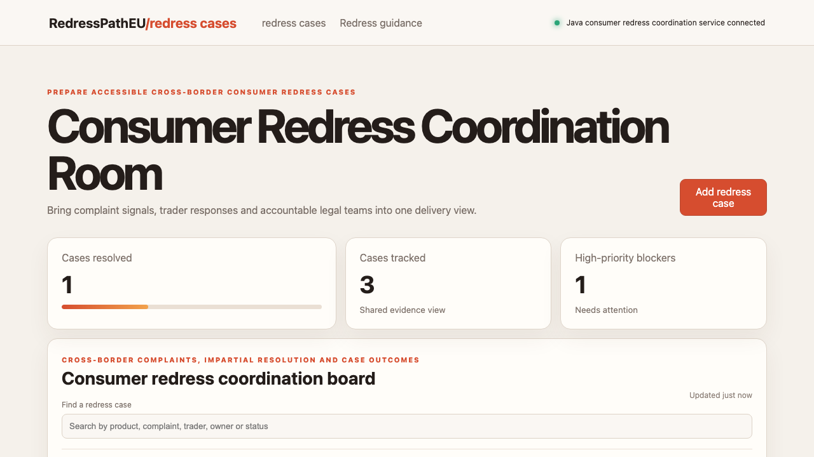

# Consumer Redress Coordination Room

## One-sentence benefit
Helps ADR bodies, consumer authorities and trader-support teams coordinate accessible cross-border consumer redress.

## Live demo
Run the Java service and Angular application locally to use the complete experience.

## Screenshots

## Main features
Search redress cases, create a regional rollout, progress readiness actions and monitor approval and high-priority gaps.

## Technology used
Angular, TypeScript, signals, computed state, server rendering, Spring Boot and Java.

## Installation instructions
Start the backend with `cd backend && mvn spring-boot:run`. In another terminal run `npm install && npm start`.

## Commercial licensing/contact
Commercial licensing and implementation support are available through the repository owner.

## Business problem and users
ADR bodies, consumer advisers, traders and cross-border authorities need shared evidence for complaints, trader replies and resolution records.

## Key workflows
Teams can find a redress case, add a validated review and advance resolution work to approval.

## Angular framework highlights
The interface uses standalone components, signals, computed values, OnPush change detection, built-in control flow and SSR-safe loading.

## Java backend highlights
The Spring Boot service provides real list, search, create and update endpoints, validation, clear errors, health reporting and tests.

## Architecture and state flow
Angular HttpClient connects signal-based state to the Java API and updates the visible board after every write.

## Accessibility and responsive behaviour
Semantic structure, labelled controls, visible focus, high contrast and compact responsive tables support varied users and devices.

## Verification commands
Use `npm test -- --watch=false`, `npm run build`, and `cd backend && mvn test package`.

## Structure
`src` contains the Angular experience, `backend` contains the Java service, and `docs` contains verified media.

## Tradeoffs
Records are held in memory for demonstration speed; operational use would add identity, durable storage, ADR systems and trader integrations.

## Roadmap
Add trader responses, mediation records, outcome notices, claimant communication and audit-ready persistence.
